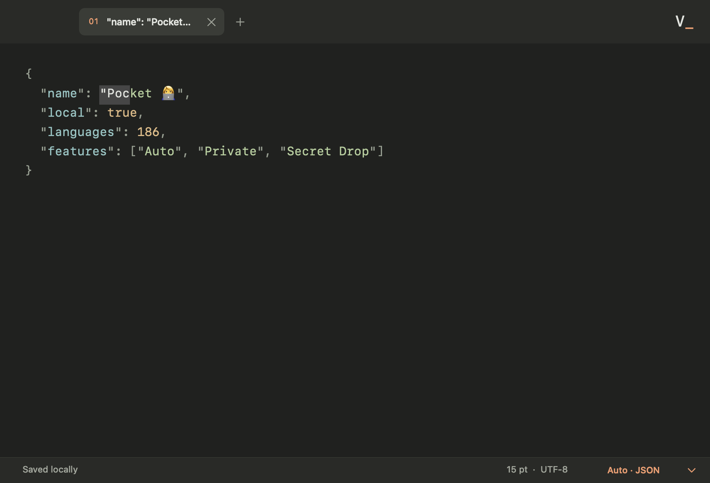
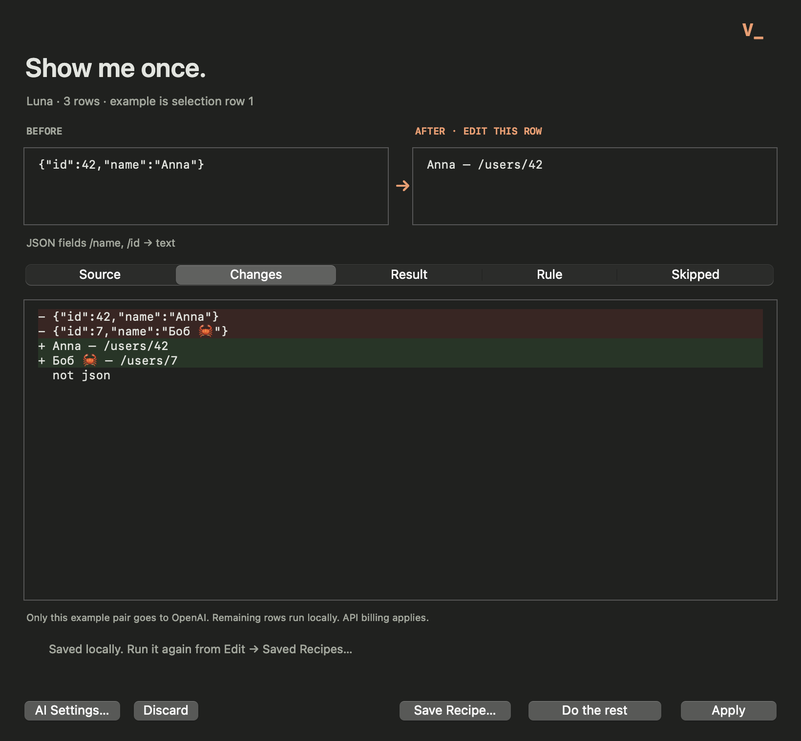

<p align="center">
  
</p>
<h1 align="center">Vibechar</h1>
<p align="center"><strong>Paste a mess. Make it useful. Get on with your day.</strong></p>
<p align="center">A tiny native text workbench for macOS and your terminal.<br>One Rust editing engine. A quiet Mac app. Optional AI when you ask for it.</p>
<p align="center">
  <a href="https://github.com/rovnyart/vibechar/actions/workflows/ci.yml"></a>
  <a href="https://github.com/rovnyart/vibechar/releases"></a>
  <a href="LICENSE"></a>
  
  
</p>
<p align="center"><a href="#install">Install</a> · <a href="#the-good-stuff">Features</a> · <a href="#show-once-run-again">Do the Rest</a> · <a href="docs/development.md">Build from source</a> · <a href="docs/roadmap.md">Roadmap</a></p>

<p align="center"></p>

## Install

```sh
curl -fsSL https://raw.githubusercontent.com/rovnyart/vibechar/main/install.sh | sh
```

On **macOS**, one install includes the GUI **and** the terminal editor. On **Linux**,
it installs the terminal editor. No sudo, account, subscription, or API key required.
The installer verifies download checksums and validates the Mac signature and
Gatekeeper assessment before replacing the app.

```sh
vc notes.md                   # native Mac app
vc -t notes.md                # stay in this terminal
vc --terminal notes.md        # same thing, spelled out
vc -- "a file with spaces.md"
vc --install                  # set up ~/.local/bin and your shell's PATH
```

On Linux, plain `vc` opens the terminal editor. On Mac, you can also choose
**Vibechar → Install vc Command…**. Open a new terminal after the initial PATH setup.
Files open in the running Mac app; missing files get a tab and reach disk on Save.

| Platform | Included |
| :--- | :--- |
| macOS 14+ · Apple Silicon | Mac app + terminal + `vc` |
| macOS 14+ · Intel | Mac app + terminal + `vc` |
| Linux · x86_64 | Terminal + `vc` |

Mac app: `~/Applications/Vibechar.app`. Command: `~/.local/bin/vc`.
[Downloads & checksums](https://github.com/rovnyart/vibechar/releases) ·
[Installation, updates and removal](docs/installation.md)

## The good stuff

| | |
| :--- | :--- |
| **A pocket, not a project** | Scratch tabs, individual files, automatic ordinary-tab recovery. Open, paste, edit, leave. |
| **Real native clients** | AppKit on Mac, Ratatui in the terminal, a shared Rust editing engine. |
| **Small editing superpowers** | Multiple selections, regex find/replace, line numbers, useful selection counters, indentation and wrapping. |
| **186 syntax grammars** | Local detection with a compact searchable override. JSON, logs, code and prose without a giant language menu. |
| **Useful before AI** | JSON format/minify, sort/deduplicate lines, trim, Unicode case, URL encode/decode. Entirely on device. |
| **Private scratch tabs** | Excluded from session recovery. Explicit saving turns them into ordinary file tabs. |
| **Secret Drop** | Let a local agent use a token in a child process without pasting its value into chat. Mac and terminal. |
| **AI with a review step** | Bring an OpenAI key on Mac. Transform a selection, inspect the diff, apply, undo. |

Projects, folder workspaces, LSP servers and plugin marketplaces are outside the
product. Vibechar is for the text between your other tools.

## Show once. Run again.

Teach **Do the Rest** one before/after row. It learns a small structural rule,
checks that rule against your example and previews the other selected rows locally.

```text
Before:  {"id":42,"name":"Anna"}
After:   Anna — /users/42

The rest:
         {"id":7,"name":"Bob"}  →  Bob — /users/7
```

**Only the example pair goes to OpenAI.** The remaining rows stay on your machine.
Review **Changes**, **Result**, **Rule** and **Skipped** before applying. Unmatched
rows keep their bytes. The whole operation is one Undo.

<p align="center"></p>

Like the result? **Save Recipe…** gives the rule a name. Next time, select new rows,
press **⌥⌘R**, choose the recipe and preview it **offline, without an AI request**.

Recipes are bounded data, never generated shell commands or scripts. v1 supports
whole rows, literal-delimited fields, flat JSON fields and `key=value` rows.
Multiline records, aggregation and guessed type conversions are outside v1.
[Exact semantics and limits](docs/development.md#do-the-rest-example-based-recipes-mac-m51)

## Keep AI optional

Mac **Settings…** (`⌘,`) stores your OpenAI key in Keychain. Choose a model and use
**Test & Save**. API usage is billed to your OpenAI account.

- **Rewrite Selection…** — `⇧⌘K`: selection + instruction → reviewable diff → Apply.
- **Keep exact** — marked occurrences are hidden from the provider and restored locally.
- **Do the Rest…** — `⌥⌘K`: demonstrate a structural transformation.
- **Saved Recipes…** — `⌥⌘R`: replay a deterministic rule locally.

AI UI and provider calls are **Mac-only**. The terminal stays a local editor with
Secret Drop. Editing and offline recipes don't require a network connection.

## Private text, practical boundaries

[Secret Drop](docs/secret-drop.md) grants a local agent temporary access to private
text as an environment variable in its child command. The value isn't included in
the prepared chat instruction. Literal stdout/stderr matches are masked; arbitrary
transformations or a program that sends the value elsewhere cannot be prevented.

Editing the private tab, Stop, closing it, quitting or inactivity revokes access.
Private tabs are excluded from recovery and cannot use AI actions or the recipe
library. Ordinary saved recipes include their rule's literal text; source rows,
teaching pairs and previews are not persisted into the recipe library.

## A few keys worth learning

| Action | Mac | Terminal |
| :--- | :--- | :--- |
| New tab | `⌘T` | `Ctrl+N` |
| Private tab | `⇧⌘N` | `Ctrl+P` |
| Next occurrence | `⌘D` | `Ctrl+D` |
| Find / replace | `⌘F` / `⌥⌘F` | `Ctrl+F` / `Ctrl+R` |
| Text tools | `⌘K` | `Ctrl+K` |
| Save / Save As | `⌘S` / `⇧⌘S` | `Ctrl+S` / `F4` |
| Paste secret for agent | `⌥⌘V` | `F8` |

[Full controls, behavior and operation budgets](docs/development.md)

## Build, test, contribute

```sh
git clone https://github.com/rovnyart/vibechar.git
cd vibechar
cargo build --release --workspace      # terminal + vc
bash scripts/build-mac.sh              # native Mac bundle; Xcode 26+
bash scripts/check.sh                 # Rust, real PTYs and native Mac smoke tests
```

Rust is pinned in `rust-toolchain.toml`. Mac builds use Swift/AppKit and Xcode's
asset compiler. The Rust core and launcher work without Swift or Apple tooling.
[Architecture](docs/architecture.md) · [Development](docs/development.md) ·
[Verification](docs/verification.md) · [Release/signing guide](docs/apple-signing.md)

This is a young editor. Broad performance comparisons, unusual filesystem cases,
IME/accessibility qualification and more terminal environments remain tracked in
the [roadmap](docs/roadmap.md). Keep backups of important text.

MIT licensed. Syntax assets retain their [upstream notices](docs/syntax-licenses.md).
UI captures use synthetic demo data; the example preview uses a local test response.
The [Graphite icon and generation prompts](apps/macos/Artwork/README.md) are included.
